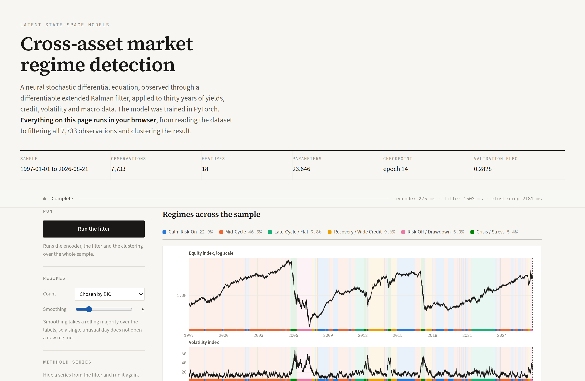

# Cross-Asset Market Regime Switching via Differentiable Latent State-Space Models

Identifies unobservable market states — liquidity crises, policy shifts,
volatility clustering — across global macro variables, yield curves, and
equities. The model is a Variational Autoencoder fused with a
continuous-time latent stochastic differential equation (SDE) and a
Differentiable Kalman Filter (DKF), trained end to end by backpropagating
through the filter, then clustered into discrete regimes.

Implements the full blueprint *"Cross-Asset Market Regime Switching via
Differentiable Latent State-Space Models"* in PyTorch, with a static
browser demo that runs the trained filter entirely client-side.

The page fetches the dataset shipped in this repository, reproduces the preprocessing, 
runs the GRU encoder and the extended Kalman filter over all 7,733 observations while the
latent trajectory draws itself, fits Gaussian mixtures for every candidate
regime count, and reports how closely it reproduces the Python results. Any
subset of the eighteen series can be withheld and the filter re-run to see
the state inferred from what is left. Alternatively, choose **My CSV** and
upload your own dataset — returns, realized volatility, and macro YoY
transforms are derived in the page and the same filter runs on your data
(see [`docs/CUSTOM_DATA.md`](docs/CUSTOM_DATA.md)).



## Architecture

```
observations x_t  (18 features: curve, credit, vol, FX, commodities, equities, macro)
      | irregular grid + missingness masks (mixed daily/monthly/quarterly frequencies)
      v
+---------------------------------------------------------------+
|  Initial-state encoder (GRU, reads window backward)            |  q(z_0 | x_{0:N})
+---------------------------------------------------------------+
      v
+---------------------------------------------------------------+
|  Latent neural SDE prior       dz = f(z) dt + g(z) dW          |
|  f = OU backbone -(LL^T+eI)z + b + zero-init MLP residual      |
|  g = diagonal softplus(c + zero-init MLP)                      |
+---------------------------------------------------------------+
      v  moment propagation (predict)         ^  gradients
+---------------------------------------------------------------+
|  Differentiable Kalman Filter (continuous-discrete EKF)        |
|  predict: m += f(m)dt,  P = FPF^T + GG^T dt,  F = I + df/dz dt |
|  update:  masked Kalman gain, Joseph-form covariance           |
|  Jacobians: torch.func.jacfwd under vmap (forward-mode AD)     |
+---------------------------------------------------------------+
      v  filtered posterior q(z_t | x_{0:t}) = N(m_t, P_t)
+---------------------------------------------------------------+
|  Emission decoder h(z)                                         |
|  - yield block constrained to a Nelson-Siegel curve            |
|    y(tau) = b0 + b1 (1-e^-lt)/(lt) + b2 [(1-e^-lt)/(lt)-e^-lt] |
|  - free MLP head for all other features                        |
|  - learned diagonal observation noise R                        |
+---------------------------------------------------------------+
      v
ELBO = E_q[log p(x|z)]  -  beta * ( KL(q_t || p_t) + KL(q_0 || N(0,I)) )
                                    (KL-annealed; closed-form Gaussian KLs)
      v  after training: freeze, filter full history, GMM + BIC
discrete regimes, transition matrix, per-regime characteristics
```

Design choices mapped to the blueprint:

| Blueprint requirement | Where |
|---|---|
| Continuous-time latent dynamics (neural SDE) | `regimelab/models/sde.py` |
| Irregular sampling / asynchronous frequencies | calendar-time `dt` + masks, `regimelab/data/preprocess.py` |
| DKF with in-graph EKF equations | `regimelab/models/dkf.py` |
| Forward-mode Jacobians (jax.jacfwd analogue) | `torch.func.jacfwd` + `vmap` in `dkf.py` |
| Economic constraint on emissions (yield curve) | Nelson-Siegel head, `regimelab/models/decoder.py` |
| ELBO with path KL | closed-form filtered-vs-predicted Gaussian KL, `models/model.py` |
| SDE training stability (start linear, clip, regularize) | OU backbone + zero-init residuals; grad clip + AdamW weight decay |
| Mode-collapse mitigation (KL annealing / beta-VAE) | `kl_beta` schedule in `training/trainer.py` |
| torchsde | prior path simulation, `sample_prior_paths` in `sde.py` |
| Regime extraction via clustering | GMM + BIC + modal smoothing, `regimelab/regimes/extract.py` |

## Quickstart

Requirements: Python 3.10+, Node 20+ (only for the browser cross-check).

```bash
pip install -r requirements.txt

# 1. data — pick one (all free sources; no API keys for the download path)
python scripts/download_data.py          # real data: FRED, Stooq, Yahoo
python scripts/make_synthetic.py         # offline validation panel with known regimes
python scripts/ingest_custom.py my_data.csv   # your own CSV (docs/CUSTOM_DATA.md)

# 2. build the aligned masked panel (skipped automatically after --custom)
python scripts/build_dataset.py

# 3. train (CPU-friendly; ~35 s/epoch on 2 cores for the default config)
python scripts/train.py --epochs 15

# 4. regimes, figures, report
python scripts/extract_regimes.py
#   -> outputs/REPORT.md, outputs/figures/*.png, outputs/regimes/*

# or everything at once
python scripts/run_all.py                # --synthetic | --skip-download | --custom my_data.csv

# 5. refresh the payload the browser demo loads
python scripts/export_web_demo.py

# tests (filter-vs-closed-form equivalence, masking, NS head, gradient flow, custom ingest, ...)
python -m pytest tests/ -q

# cross-implementation check: the browser engine against the Python filter,
# plus the custom-upload pipeline against the shipped panel
node scripts/verify_web_demo.mjs
```

### Using your own data

No code changes needed — two paths, same transforms. Missing values are never
imputed: leave a cell empty (or `NaN`) and the filter masks it, exactly as it
does for the TED spread after discontinuation or macro releases between prints.

- **Browser (easiest):** open the demo, pick **My CSV**, upload, press Run.
  Yields/credit/VIX levels are used directly; equity returns and 21-day
  realized vol are derived from raw closes; macro YoY from raw levels. A
  **Template** button downloads the expected layout.
- **Python:** `python scripts/ingest_custom.py my_data.csv [--start/--end]`,
  then `extract_regimes.py` (filter with the shipped checkpoint) or `train.py`
  to refit. Column aliases (`DGS10`, `^GSPC`, `DXY`, `CPIAUCSL`, …) are
  accepted; provenance lands in `data/processed/custom_source.json`.

Full reference: [`docs/CUSTOM_DATA.md`](docs/CUSTOM_DATA.md). Minimal example:
[`data/custom_template.csv`](data/custom_template.csv).

### Running the demo locally

The page is plain static files with no build step and no dependencies, but it
uses ES modules and `fetch`, so it needs to be served over HTTP rather than
opened from disk:

```bash
python -m http.server 8000 --directory docs
# then open http://localhost:8000
```

### Publishing it

In the repository settings, under Pages, set the source to "Deploy from a
branch", branch `main`, folder `/docs`. Nothing else is required: no build
step, no Actions workflow, and no third-party requests at runtime. The
typefaces are served from `docs/fonts/` rather than a font CDN, so the page
renders identically offline.

## Data (100% free and open)

| Series | Source | Notes |
|---|---|---|
| Treasury curve 3m/2y/5y/10y/30y | FRED `DGS*` | Nelson-Siegel-constrained block |
| HY & IG corporate OAS | FRED `BAMLH0A0HYM2`, `BAMLC0A0CM` | credit stress |
| VIX | FRED `VIXCLS` | log level |
| TED spread | FRED `TEDRATE` | discontinued 2022, kept and masked after (by design) |
| Broad USD index | FRED `DTWEXBGS` | starts 2006, masked before |
| WTI crude | FRED `DCOILWTICO` | guarded returns (Apr-2020 negative print) |
| S&P 500, Nasdaq | Stooq `^spx`/`^ndx`, fallback Yahoo, fallback FRED | log returns + 21d realized vol |
| CPI, INDPRO, UNRATE | FRED, monthly | YoY transforms, sparse-masked |
| Real GDP | FRED `GDPC1`, quarterly | YoY, sparse-masked |

Missing values are never imputed for the model: every feature carries an
observation mask, and the continuous-discrete filter simply skips the update
for unobserved dimensions. Monthly/quarterly series update the state on
release days and contribute nothing on other days. `dt` is measured in
calendar years, so weekends/holidays stretch the SDE integration interval.

The dataset itself is committed under `data/raw/` so the pipeline and the
demo both run immediately after a clone, with no download step and no API
keys. `data/processed/` is derived and regenerated by `build_dataset.py`
(or by `ingest_custom.py` for user-supplied CSVs).

The repository also includes a calibrated synthetic generator
(`scripts/make_synthetic.py`) that reproduces the panel's structure,
including the TED discontinuation and the USD index's late start, from a
hidden 4-state Markov chain, so the whole system can be validated against
known regime truth (adjusted Rand index in the report).

## Configuration

All knobs live in typed dataclasses in `regimelab/config.py` (window length,
latent dimension, KL annealing fraction, GMM search range, ...). Scripts
expose the common ones as CLI flags. Training metrics stream to
`outputs/checkpoints/metrics.jsonl`; hook up MLflow/W&B by tailing that file
if you want experiment tracking.

## Numerical notes

- Everything runs in float64: filters are Cholesky-based and double precision
  keeps 100-step covariance recursions comfortably PSD (plus Joseph-form
  updates, symmetrization, jitter floors).
- Masked updates use zeroed Jacobian rows + unit placeholder noise, which is
  provably identical to the reduced-dimension update (unit-tested) while
  keeping fixed shapes for batching.
- The blueprint's JAX/Diffrax variant maps 1:1: `jacfwd`/`vmap` here are the
  torch.func ports of the JAX operators it recommends.

## Repository layout

```
regimelab/
  config.py            feature spec + typed configs
  data/     sources.py (FRED/Stooq/Yahoo), preprocess.py (align/mask/scale),
            dataset.py (windowed torch Dataset), synthetic.py (validation generator)
  models/   sde.py (neural SDE), dkf.py (differentiable EKF), decoder.py
            (Nelson-Siegel emissions), encoder.py (GRU initial state), model.py (ELBO)
  training/ trainer.py (KL annealing, clipping, early stop, checkpoints)
  regimes/  extract.py (GMM+BIC, naming, transitions, ARI scoring)
  viz/      plots.py (report figures)
scripts/    download_data / make_synthetic / ingest_custom (your own CSV) /
            build_dataset / train / extract_regimes / run_all
tests/      filter equivalence, masking, NS head, SDE init, ELBO gradient flow,
            data alignment, regime post-processing, custom ingest
docs/       the GitHub Pages demo
  index.html, css/style.css, CUSTOM_DATA.md (upload reference)
  js/engine.js  linear algebra, the model forward pass with analytic Jacobians,
                the EKF, and Gaussian-mixture clustering, all in plain JS
  js/custom.js  CSV parsing + return/YoY/scaling transforms for uploads
  js/charts.js  canvas renderers, no plotting library
  js/app.js     preprocessing, the run loop, and the controls
  data/         the panel, the exported weights, and the Python reference results
  fonts/        self-hosted woff2 subsets, 108 KB total
outputs/    checkpoints/, figures/, regimes/, REPORT.md
```

## The browser port

`docs/js/engine.js` is a direct port of the inference half of the pipeline.
Both the drift network and the decoder are linear-tanh-linear, so the
Jacobians the filter needs are written out analytically rather than
differentiated, and they agree with what `torch.func.jacfwd` produces to
machine precision. `docs/js/custom.js` applies the documented preprocessing
transforms to user uploads with no dependencies.

`scripts/verify_web_demo.mjs` runs that engine under Node against the same
dataset and compares its filtered trajectory with the one Python produced.
The current agreement is a maximum absolute deviation of 5e-7 across all
7,733 steps and six latent dimensions, which is the rounding precision of
the reference file that ships with the repository. Regime labels agree with
the Python Gaussian mixture at an adjusted Rand index of 0.96, and the
browser's BIC curve selects the same regime count. The same script rebuilds
the shipped panel through the upload pipeline and requires bit-for-bit
agreement. Both checks run in CI, so the implementations cannot drift apart
silently.

## Results (current run: synthetic validation panel, 1997-2026)

Trained 15 epochs (~9 min on 2 CPU cores), val ELBO 0.68 -> 0.28, KL steady
at ~0.08 (no posterior collapse). All 31 unit tests pass, including exact
equivalence of the masked DKF update with the closed-form reduced-dimension
Kalman update.

The extraction recovered the generator's hidden 4-state Markov chain with
**adjusted Rand index 0.83** when clustering at the true k = 4;
unconstrained BIC prefers k = 6, splitting the calm and crisis states into
sub-states (ARI 0.45 at that granularity, which merges back to the same
structure). Regime characteristics line up with their definitions. The crisis
cluster carries VIX ~38, HY OAS ~10%+, deeply negative annualized returns;
the calm clusters VIX ~14 and positive drift; transitions route crisis ->
recovery -> calm.

See `outputs/REPORT.md` for the full regime table, transition matrix, BIC
table, and figures. This run used the synthetic generator because the build
environment had no outbound access to the market-data endpoints. Run
`scripts/download_data.py` on a normal connection and rerun
`build_dataset.py` / `train.py` / `extract_regimes.py` to produce the same
report on live FRED/Stooq data.

## Foundational papers

1. Neural SDEs: "Neural Stochastic Differential Equations" (Liu et al., 2019)
   / "Latent SDEs" (Li et al., 2020 — related to torchsde).
2. Deep Kalman Filters: "Deep Kalman Filters" (Krishnan et al., 2015).
3. Differentiable filtering: papers combining Kalman filtering layers within
   PyTorch/JAX pipelines for time-series.

## License

Licensed under the Apache License, Version 2.0. See
[LICENSE](LICENSE) for the full text.
